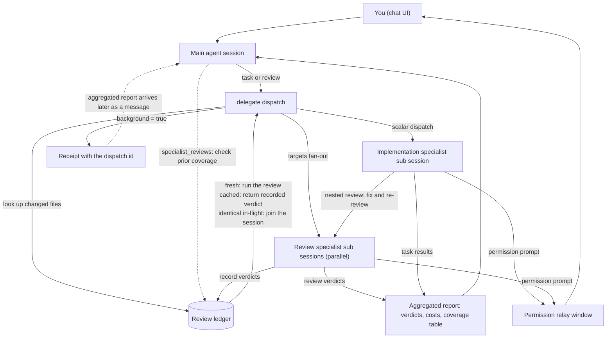

<!--
SPDX-FileCopyrightText: 2026 Aidan Gauland <aidalgol+git@fastmail.net>

SPDX-License-Identifier: MIT
-->

# Maki `specialist-subagents`

Maki plugin for defining custom specialist subagents with delegation workflows
built into the harness: a two-type specialist system, nested delegation, a
review ledger that deduplicates reviews by file content and review scope, and
budgets that bound the cost of deep delegation trees. It is inspired by the
generic agent definitions in other coding agents such as OpenCode.

## What the plugin provides

| Tool / command             | Audience    | Purpose                                                                                                                                                                                                                                |
| -------------------------- | ----------- | -------------------------------------------------------------------------------------------------------------------------------------------------------------------------------------------------------------------------------------- |
| `delegate`                 | main only   | Dispatch specialists: one scalar dispatch, or a `targets` list that fans out in parallel and returns one aggregated report. `background = true` runs the dispatch in the background; `action` queries or reaches in-flight dispatches. |
| `specialist_reviews`       | main + subs | Read-only ledger query: which changed files have review coverage that is fresh against the current file content and review scope.                                                                                                      |
| `/specialists`             | user        | Catalog, live invocations, recent coverage.                                                                                                                                                                                            |
| bundled skill              | main        | `specialist-subagents` skill that documents how to author specialist definitions; see [Bundled skill](#bundled-skill).                                                                                                                 |
| prompt hint (`tool_usage`) | main        | Fresh catalog plus delegation guidance, rebuilt every run.                                                                                                                                                                             |

No command dispatches specialists. You ask the top-level Maki
agent to hand off parts of the task to a specialist, for example:

> Have the technical-writer specialist review the uncommitted changes.

> Have the test-engineer specialist write a test plan for the uncommitted code
> changes.

> Write a plan to add a new section to the user preferences screen for theming
> options. Consult the ux-designer specialist when drafting your plan. Have the
> test-engineer specialist review your draft plan and propose a test plan.

A dispatch flows from your session through the specialist sessions and
returns as one aggregated report:



## Specialist definitions

A specialist is defined by a Lua module and a markdown instruction file, located under either the project-local `.maki/` directory or the user's global Maki config directory.

- Project: `<project>/.maki/lua/specialists/`
- Global: `~/.config/maki/lua/specialists/`

The basename of the Lua module must be a valid require path, but nothing
restricts the markdown file. For example, `test_engineer.lua` +
`test-engineer.md` would be valid; `test-engineer.lua` + `test-engineer.md`
would not.

```lua
-- .maki/lua/specialists/scss_reviewer.lua
-- "scss_reviewer" is the stem.
return {
  -- Required. Must be unique and contain only lower alphanumeric characters and dashes.
  name = "scss-reviewer",

  -- Required. May be "review" or "implementation".
  type = "review",

  -- Required. Brief description of the specialist's role.
  description = "Reviews SCSS for selector hygiene, BEM compliance, and dead styles.",

  -- Optional. Name of the instructions file. Defaults to "<name>.md" if not specified.
  instructions = "scss-reviewer.md",

  -- Optional. Specifies a model tier or exact model. Defaults to the parent
  -- model if unspecified.
  model = {
    tier = "weak" -- Clamped to the parent's tier.
    -- spec = "..."  -- Pins one model; wins if both tier and spec are set.
  },

  -- Optional. Capped at the parent's thinking level.
  thinking = "low",

  -- Optional.
  -- `only` and `exclude` are mutually exclusive.
  -- Defaults differ depending on the value of `type`. See below.
  tools = {
    -- Explicitly specify tools available to this specialist.
    only = { "read", "index", "grep", "glob", "list", "bash" }
    -- Exclude certain tools from the defaults.
    -- except = { "..." }
  },

  -- Optional. Advisory only. Indicates to the user which files to which this
  -- specialist applies.
  review = { files = { "**/*.scss" } },

  -- Optional. Caps the fix<->re-review iterations on this specialist's
  -- reviews. Valid for both types.
  max_iterations = 3,

  -- Optional. Omit project instruction files (AGENTS.md etc.) from the base
  -- prompt.
  omit_agents_md = true,

  -- Optional. Give the specialist the parent chat's MCP servers' tools.
  -- Default false; valid for both types. Maki injects their definitions each
  -- turn (deferred behind `tool_search`), so do not list MCP tools in `tools`.
  -- Cost caveat: on a chat with MCP servers, the session prices at every
  -- plugin permission except `agent` and `input`, so the plugin must hold
  -- them (it holds `env` and `session_settings` for this reason). On a chat
  -- without MCP servers it costs nothing. If the plugin cannot pay, dispatch
  -- fails with the host's permission error naming the shortfall.
  mcp = true,

  -- Optional. Skills for this specialist to always load. Valid for both
  -- types.
  skills = { "maki-plugin-dev" },
}
```

One additional field that is valid only when `type = "implementation"`.

```lua
return {
  -- ...

  -- Allow the specialist to have any reviewer specialist review its own
  -- changes. Nested delegation exists for this fix<->re-review loop;
  -- cross-discipline routing is the main agent's job, so `kind = "task"`
  -- dispatches from a nested session are refused.
  delegate = { reviews = true },
}
```

An invalid definition prevents the plugin from loading: Maki logs an error
naming each broken file, with a reason. Rather than leaving you to discover
mid-session that specialists you expected would never run, the error tells you
up front, saving your time and tokens.

Non-fatal issues can still occur; the plugin still loads, but how you
learn of them depends on the kind of issue.

At load, definition problems such as duplicate specialist names and invalid keys
become discovery warnings. `/specialists` lists them under "Discovery warnings",
and the delegation guidance shown to the main agent includes them. Nothing is
written to the log.

At dispatch time, problems with a specialist's environment are logged, such as
a requested skill or instruction file that cannot be found. These surface only
in the log, so a specialist can run without its intended instructions if you do
not check.

Because the global specialist definitions are always read, a broken
global specialist disables the plugin in every project.

### Tool defaults

The default tools available to a specialist depend on the value of the `type`
field in the specialist definition.

#### Review

When `type = "review"`, the specialist has read tools plus `bash` and the web
tools. Review tools are broad because a definition cannot know ahead of time
what the job needs; Maki's permission system is the security mechanism. You can
remove any tools via the specialist table field `tools.except`.

#### Implementation

When `type = "implementation"`, the specialist has the full `general_sub`
toolset, minus interactive tools, plus a nested review-delegation local tool
when `delegate.reviews` is set (`kind = "task"` is main-only). Two classes of
tool are always excluded, because maki prices either at permissions this
plugin does not hold:

- Over-cost containers: `batch`, `code_execution`, and `task`.
- Capability-less built-ins: `skill`, `todo_write`, `memory`, `view_image`,
  `task_stop`, and `task_message` declare no capability, which prices the
  session at every permission except `agent` (more than the plugin's grants).

A capability-less tool never stops a session from running: when maki refuses
to open a session because of a refused tool, the builder retries without it
and logs a single warning naming everything that was dropped. Note that
`skills = { ... }` in a specialist definition still works even though `skill`
is excluded: skill bodies are injected into the system prompt at dispatch time,
not loaded by the sub session's own `skill` tool.

## Background dispatches and in-flight actions

A review fan-out can run long. `background = true` on a `delegate` call (scalar
or `targets` form) returns a receipt immediately: the dispatch id (`bg-<n>`,
for example, `bg-3`), the specialists involved, and any targets refused at
validation. The fan-out then runs in a task that outlives the tool call. When
it completes, the plugin delivers the aggregated report to the session as a
message (via `maki.session.notify` with `wake = true`). The report is the same
aggregate and review coverage audit a synchronous call returns, so the
model's next turn reads it without the user doing anything.

Do not re-dispatch while a background dispatch runs: the review ledger
deduplicates unchanged content and joins identical in-flight reviews anyway.

Background dispatches are main-only: a nested delegate's call must stay
synchronous so its result reaches the specialist's own report. They are disabled
when `allow_background = false`. They are also refused without a task UI (for
example, under `maki -p`), which has no session to wake; the error says to
dispatch synchronously.

While a dispatch runs, `action` operates on its specialists instead of
dispatching new work:

| `action`  | Effect                                                                                                                                                                                                                                                                                                                                                                                                                                                                        |
| --------- | ----------------------------------------------------------------------------------------------------------------------------------------------------------------------------------------------------------------------------------------------------------------------------------------------------------------------------------------------------------------------------------------------------------------------------------------------------------------------------- |
| `status`  | List the in-flight dispatches from this session: ids, elapsed time, and per-specialist state. Read-only, allowed from any invoker.                                                                                                                                                                                                                                                                                                                                            |
| `message` | Queue `text` to each matched specialist's live session via `Session:send`; it lands at the sub's next turn boundary as an interrupt from its parent. If that send fails while the specialist's task is still live, the text is retried through `maki.session.notify`'s `task` path instead, and the result row says which path delivered. Either way, a compaction is queued (reason `requested`) on the specialist session so its continued run has context room. Main-only. |
| `stop`    | Close each matched live session, so its blocked prompt returns as cancelled and the normal failure path releases claims and in-flight ledger keys. Main-only.                                                                                                                                                                                                                                                                                                                 |

The `dispatch` option targets one dispatch by id (from a receipt). Without
it, the action applies to every in-flight dispatch opened from this session;
an explicit id from another session does not match.

### Compaction around specialist dispatches

Two behaviours keep compaction from interfering with delegation (both can
be disabled; see [Configuration](#configuration)):

- **Deferring an automatic compaction.** While dispatches opened from a session are
  still running, an `agent.compact.before` layer defers an automatic
  compaction of that session by one turn: the model gets a turn to record
  the in-flight dispatch ids before the summary replaces the history. maki
  grants at most one such defer between two compactions, ignores `defer`
  for manual, overflow, and requested compactions, and cannot skip an
  overflow at all. The defer text carries dispatch counts and ids only,
  never model or user text.
- **Requesting compaction on specialists.** After `action = "message"`
  delivers text into a live specialist session, a compaction is queued on
  that specialist session (reason `requested`). The parent chat session is
  never compacted by the plugin; compacting it stays the user's business.

## The `AGENTS.md` gate recipe

If you want some of your specialists to act as a final review gate, verified by
the harness rather than trusted as a convention, put the following recipe in
your project's `AGENTS.md` (or instructions):

> Before finishing, dispatch the relevant area specialists in one `delegate`
> `targets` call (your judgment; see `specialist_reviews` for prior
> coverage). Completion requires the report's coverage table to show every
> changed file passing, with no `UNCOVERED` entries. Previously reviewed
> content returns instantly from the ledger.

The gate relies on both the dedup and the audit: the model chooses whom to
invoke, and the harness computes what was missed. A final re-review of
unchanged content is a cache hit, so the gate costs nothing the earlier
reviews did not already spend.

## Installing the plugin

Global config:

```lua
-- ~/.config/maki/init.lua
maki.pack.add({
  {
    src = "https://github.com/aidalgol/maki-specialist-subagents",
    -- Optionally specify a release.
    -- version = "v0.1.0",
  },
})
```

This repository itself also uses the plugin: four specialists under `.maki/`.

- `lua-code-reviewer`
- `technical-writer`
- `security-engineer`
- `test-engineer`

## Bundled skill

This plugin pack includes a `specialist-subagents` skill that documents how
to author specialist definitions: the file layout, the complete definition
schema, per-type tool defaults, the failure modes, how to write instruction
files, and a primer on how `delegate` invokes specialists.

Maki has no mechanism for a plugin to provide a skill, so you must install it
manually.

Either copy the skill from the installed pack, or check out the source
repository and symlink the skill from your checkout.

```sh
# Copy from an installed pack (the rev directory changes on update):
mkdir -p ~/.config/maki/skills
# Replace abcd... with the revision hash of the installed pack.
cp -r \
  ~/.local/share/maki/site/pack/core/maki-specialist-subagents/abcd.../skills/specialist-subagents \
  ~/.config/maki/skills/
```

```sh
mkdir -p ~/.config/maki/skills
ln -s ~/src/path/to/maki-specialist-subagents/skills/specialist-subagents \
  ~/.config/maki/skills/specialist-subagents
```

Whichever method you choose, keep the skill in sync with the installed
version of the plugin; a stale skill misleads the main agent during
specialist work. Keep these points in mind:

- A copy is frozen at the revision you copied. Re-run the `cp` after a pack
  update.
- A symlink into the pack revision directory goes stale when the pack
  updates. Prefer the source-checkout symlink.
- A project-local `.maki/skills/specialist-subagents/` directory overrides
  the global copy. A project-local install is not recommended unless the
  project vendors a matching version of the plugin itself. The directory
  does not exist in a fresh project; create it if you want a project-specific
  variant of the skill.
- The `skill` tool discovers the file on the next Maki start or `/reload`.

## Permissions guidance

`plugin.toml` grants exactly `agent`, `fs_read`, `fs_write`, `run`, `net`,
`session_read`, `session_write`, `env`, and `session_settings`; it denies
`input`. `net` exists only so specialists can be handed the native
`webfetch`/`websearch` tools and the permission relay can see their prompts;
the plugin itself makes no network calls and records no permission rules.
`env` and `session_settings` exist only so a `mcp = true` specialist can pay
the host's MCP hand-over pricing on a chat with MCP servers; the plugin makes
no `env` reads and no `session_settings` API calls. The plugin never widens
anyone's authority: no pre-approvals, no private execution channels, and no
calls to `register_permission_rule`
or `set_prompt`. The plugin wraps two maki slots. The `permission.prompt`
slot answers prompts in the user's name and never bypasses a deny. The
`agent.compact.before` slot (see
[Compaction around specialist dispatches](#compaction-around-specialist-dispatches))
can defer one automatic compaction by one turn and never skips a manual,
requested, or overflow compaction.

Sub sessions cannot answer permission prompts, so by default a call that
would prompt is denied. Two mechanisms fill that gap:

**Permission relay (default on; `permission_relay = false` disables).** When
a specialist sub session's call would prompt (maki fires the
`permission.prompt` slot for subagent calls too), the plugin opens a small
window next to the chat input in the parent UI. The window shows the
specialist name and kind, the tool, the command or input, and the scopes
the prompt asks about. Keys:

- `y`: allow once, so the call runs with no model round trip.
- `s`: allow for this specialist, remembered in memory until the session
  closes, so a repeated identical call (same tool, same scopes) runs silent.
- `n` (or `Esc`): deny, so the sub receives a guidance message and adapts.

While the window is open the status bar shows the `y` / `s` / `n` keys
(`maki.ui.set_status_hint`), cleared when the window closes or times out.

The window waits 55 s; if nobody answers (or the window cannot open, for example,
under `maki -p`), the call is denied with guidance instead of hanging the
sub. Verdicts record no rules host-side, so relays never persist: allow-always
answers live only for the session, and `.maki/permissions.toml` remains the way
to pre-allow recurring commands. Attribution is re-verified against the live
task list on every relay, so a closed session's cache expires with it. Calls
from the main session and from other plugins' subagents pass the layer
untouched, and deny rules and escalated (`ask`) calls never reach it.

The plugin holds `net`, so `webfetch`/`websearch` calls relay like any other
prompted call: with no project rule, the relay window appears; whether web
tools are allowed in a project is decided by its Maki permission rules.
Pre-allow rules cover the rest:

- file writes by implementation specialists inside the project are
  pre-allowed by maki's builtin `<cwd>/**` rule;
- add project rules (`.maki/permissions.toml`) for the lint and
  static-analysis commands your review specialists run, for example,
  `ruff *`, `npm run lint*`, `cargo check *` (cheaper than answering the
  relay window on every dispatch);
- to block web tools in a project, add deny rules for `webfetch`/`websearch`
  (or never allow them at all); to silence the relay for frequent fetches,
  pre-allow a rule such as `webfetch *`.

The plugin's own process execution is a fixed git channel only
(`status`, `diff`, `rev-parse`, `hash-object` via argv arrays); everything a
specialist runs goes through maki's native `bash` tool and its permission
machinery.

## Configuration

```lua
-- optional, from ~/.config/maki/init.lua
require("specialist_subagents").setup({
  max_active = 6,          -- concurrent specialist sessions
  per_turn_budget = 16,    -- delegations per tool call (every target counts)
  review_max_depth = 2,    -- nested review depth cap
  iteration_cap = 3,       -- fix<->re-review rounds per (implementer, reviewer, scope)
  strict_claims = false,   -- reject overlapping path claims instead of warning
                           -- (cross-dispatch and cross-specialist; overlap within
                           -- the same dispatch to the same specialist is exempt)
  ledger_cap = 500,        -- persisted review ledger entries per project
  permission_relay = true, -- show specialist permission prompts in the parent UI
  allow_background = true, -- allow background delegate calls (receipt now, report as a message)
  defer_compact = true,    -- defer an automatic compaction once while this session's
                           -- specialist dispatches are running (agent.compact.before layer)
  compact_specialists = true, -- queue a compaction on a specialist session after
                              -- action = "message" delivers into it
})
```

The ledger persists under `~/.local/state/maki/specialists/<hash(project
cwd)>/ledger.json`. Entries are keyed by the reviewed file's fingerprint and
the review-time scope context (a hash over every file in the reviewed set).
A verdict is reused only when a later dispatch presents the same context: the
same files, unchanged. A change to any file in the scope therefore invalidates
the verdicts of the other files in the reviewed set too, because the reviewer
renders one changeset-level verdict against the whole diff. Entries persisted
by older plugin versions carry no context and never hit. The first review
after the upgrade therefore re-reviews and re-records. `force_review = true`
still bypasses the cache explicitly.

## Development

Because this project's `.maki/` loads the plugin itself, a global install of
the plugin clashes with it. Temporarily disable loading in your global config
before launching Maki in this project.

The specialists in this project use pinned model IDs for the inference provider
Synthetic. If you use a different provider, change the
`model` table before launching Maki in this project.

Support in this plugin for collaborators using different providers with
different available model IDs is planned.

### Testing

Code that does not need to call into the Maki API is unit-tested with
[LuaUnit](https://github.com/bluebird75/luaunit), vendored as the submodule
`external/luaunit`. The standalone Lua interpreter is used because Luau's
require-by-string refuses this repository's layout (the entry file
`lua/specialist_subagents.lua` beside the package directory
`lua/specialist_subagents/` is an ambiguous component), while Lua's
`package.path` require resolves it.

```sh
$ lua spec/run.lua
```

Live-session behaviour (dispatch, cache hits, joins, nested delegation) requires
manual testing.

1. `/reload` in a project with specialists; check `/specialists` for
   definition warnings.
2. Ask the agent to run `delegate` with `specialist_reviews` first, then a
   review fan-out; confirm parsed verdicts, token costs, and the coverage
   table.
3. Repeat the same review; expect `CACHED REVIEW` with zero session spend.
4. Dispatch an implementation task to `test-engineer`; confirm it lands a
   passing spec in `spec/` and confirm its local `delegate` tool offers only
   its enabled review targets (`delegate.reviews`).
5. Ask a delegated specialist to dispatch a task; expect a refusal from the
   harness, not from a prompt; work outside its brief comes back as a flagged
   gap in its report.
6. Run two identical reviews concurrently from two calls; expect one
   `JOINED IN-FLIGHT SESSION` result.
7. Ask for a background review fan-out (`background = true`); confirm the
   receipt names a `bg-<n>` id and arrives immediately, the aggregate report
   lands as a message, the ledger records the verdicts, and a repeat review
   is a cache hit. Check `/tasks` shows the backgrounded specialists and
   that permission-relay attribution still works.
8. While it runs: `action = "status"` lists the dispatch with per-specialist
   state; `action = "message"` with `text` queues to a running specialist
   (visible in its transcript); `action = "stop"` closes the live sessions
   and the original receipt's dispatch finishes with `cancelled` results,
   claims released. Confirm `maki -p` refuses `background = true` with a
   clear error, and that a nested or implementation delegate sending
   `background = true` is refused.
9. Break a definition (introduce a syntax error, for example), `/reload`, and
   confirm maki logs a plugin-load error that names the file and the reason
   while `delegate` is absent; fix the definition, `/reload`, and confirm the
   tool registers again. A definition that only warns (a `model.tier` next to
   a `model.spec`, or an unknown key) still loads the plugin.
10. With a background dispatch running, force an automatic compaction of the
    parent chat session (for example by padding the context past its
    threshold). Expect the compaction to be deferred once, with a save-turn
    message naming the running dispatch ids, and the compaction to resume on
    the next turn. With `defer_compact = false`, expect no defer.
11. Use `action = "message"` on a running specialist whose context is large;
    confirm the specialist compacts (reason `requested`) before its continued
    run, and that the parent chat session is never compacted this way.
12. In a non-YOLO session, trigger a specialist permission relay window;
    confirm the status bar shows the y/s/n hints, and that they clear on
    both an answer and the 55 s timeout.
13. With `strict_claims = true`, dispatch two same-specialist task targets
    with overlapping claims in one fan-out; expect neither a warning nor a
    refusal. Confirm a foreground task still refuses against a
    still-running background dispatch with overlapping claims.
